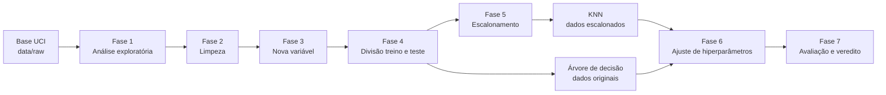
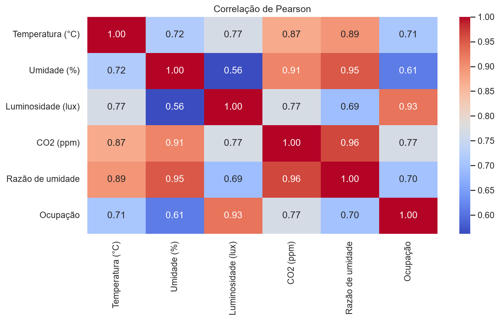

# Detecção de ocupação de ambientes com sensores IoT

Projeto avaliativo do curso SCTEC Aperfeiçoar - Integração de IA com Dados.

### Turma: T1
### Aluno: Eric Felipe Barros Marques

## Problema

Em um complexo industrial com sensores ambientais, é preciso saber se uma sala está ocupada ou vazia para desligar o ar-condicionado e a iluminação quando não há ninguém, reduzindo o gasto de energia.<br>Neste projeto monto um pipeline de ciência de dados que prevê essa ocupação (0 = vazia, 1 = ocupada) a partir de leituras de sensores.

## Dados

Uso o Occupancy Detection Dataset, do repositório UCI Machine Learning Repository.<br>As variáveis são temperatura, umidade, luminosidade, CO2, razão de umidade e a ocupação, que é a variável alvo.

Os arquivos ficam na pasta `data/`. O notebook baixa os dados automaticamente caso ainda não existam.

## Técnicas e tecnologias

- Python, pandas e numpy para manipulação dos dados
- matplotlib e seaborn para os gráficos
- scikit-learn para os modelos (KNN e Árvore de Decisão)
- Jupyter Notebook
- Git e GitHub para versionamento e organização das tarefas

O notebook segue sete fases: análise exploratória, limpeza dos dados, criação de uma nova variável, divisão treino e teste, escalonamento, ajuste de hiperparâmetros e avaliação final.

## Fluxo do pipeline


## Estrutura do repositório

- `data/raw/`: arquivos originais da base, sem alteração
- `data/processed/`: dados tratados, gerados no notebook
- `notebooks/analise_exploratoria.ipynb`: notebook com todo o pipeline
- `requirements.txt`: dependências com as versões usadas
- `README.md`: esta documentação

## Como executar

1. Clone o repositório e entre na pasta do projeto.
2. Crie e ative um ambiente virtual:

```
python -m venv venv
venv\Scripts\activate
```

No Linux ou macOS, a ativação é `source venv/bin/activate`.

3. Instale as dependências:

```
pip install -r requirements.txt
```

4. Abra o notebook em `notebooks/analise_exploratoria.ipynb` e execute as células em ordem.

## Organização do trabalho

Organizei as tarefas em um quadro no GitHub Projects, uma por fase do notebook. Usei a branch `develop` para reunir o trabalho e criei uma branch de feature para cada tarefa, integrada por pull request.


## Análise exploratória

A base tem duas classes, com cerca de 64% de leituras de ambiente desocupado e 36% de ocupado.<br>A luminosidade é a variável mais relacionada à ocupação (correlação de 0,93), seguida pelo CO2 (0,77). A razão de umidade é muito correlacionada com a umidade e o CO2, por ser derivada de temperatura e umidade.v



## Limpeza dos dados

Removi 82 linhas duplicadas (de 2665 para 2583) e não encontrei valores ausentes.<br>Nos boxplots, só a luminosidade tem outliers (3 leituras), que mantive por parecerem leituras reais. A base tratada é salva em `data/processed/`.

## Feature engineering

Criei a variável `razao_co2_luz`, calculada como CO2 dividido por (luminosidade + 1), somando 1 para evitar divisão por zero, já que cerca de 59% das leituras têm luminosidade zero.<br>Ela tem correlação de -0,87 com a ocupação e combina as duas variáveis mais relacionadas ao alvo.

## Divisão dos dados

Dividi a base em 80% para treino e 20% para teste, com estratificação pela variável alvo e semente fixa (`random_state=42`).<br>A divisão é feita antes de qualquer escalonamento, para evitar vazamento de dados do conjunto de teste para o treino.

## Escalonamento

Apliquei o `StandardScaler` só nos dados do KNN, ajustando (`fit_transform`) com o treino e apenas aplicando (`transform`) no teste.<br>A árvore de decisão usa os dados originais, porque o escalonamento não altera os cortes que ela encontra.

## Ajuste de hiperparâmetros

Testei o KNN com K = 1, 3, 5, 7 e 15 e a árvore de decisão com `max_depth` = 2, 3, 5, 10 e sem limite, comparando a acurácia no treino e no teste.<br>Houve overfitting leve com K = 1 e com as árvores mais profundas (profundidade 10 e sem limite).<br>As configurações mais estáveis foram K = 3 e `max_depth=5`, ambas com acurácia de teste acima de 99%.

## Resultados

No conjunto de teste, a árvore de decisão (`max_depth=5`) teve acurácia de 99,23% e o KNN (K = 3) teve 99,03%, uma diferença de uma leitura.<br>Recomendo a árvore de decisão para o sistema, por não precisar de escalonamento, ser mais rápida e ter regras de fácil leitura.

## Melhorias futuras

- Usar validação cruzada ou um conjunto de validação separado para escolher os hiperparâmetros, sem usar o teste.
- Dividir os dados por período (treino em dias anteriores, teste em dias seguintes), em vez de aleatoriamente.
- Usar os três arquivos da base original como foram propostos (um para treino e dois para teste) e coletar dados de mais dias e ambientes.
- Avaliar outras métricas, como precisão, recall e matriz de confusão, e não só a acurácia.
- Testar a previsão em fluxo contínuo, como em um sistema em tempo real.

## Vídeo de defesa
 
Apresentação técnica do projeto em formato de Review de Sprint:
- pipeline Python
- modelo estrela no MySQL
- dashboard no Power BI
- planejamento em Sprints
- histórico de commits.

[Assista ao vídeo no Google Drive](LINK)